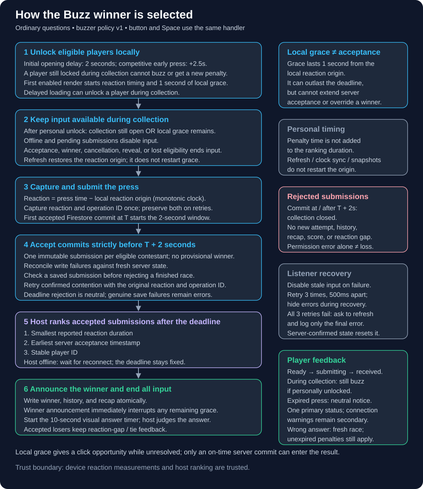
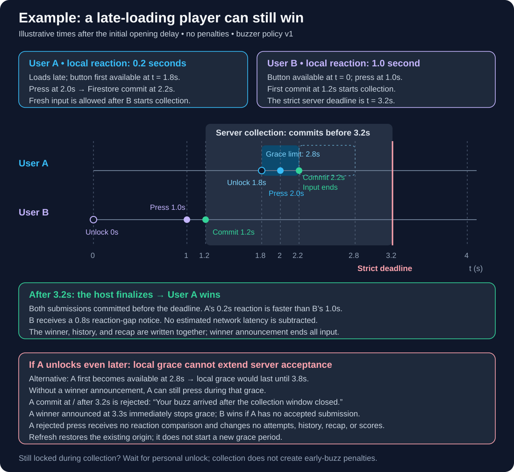

# How the Buzz winner is determined

The winner is the eligible contestant with the **smallest reported local reaction duration among accepted submissions**. The first Firestore commit starts a two-second collection window. The host finalizes the result after that window closes.

These diagrams describe ordinary questions in rooms with `buzzerPolicyVersion: 1`. Existing rooms without that policy keep their previous behavior. Surprise questions use their separate contestant-selection flow.

## Selection flow

The initial opening delay is **2 seconds**. A reaction starts when the local client renders the button as available. Button and Space presses use the same handler. The client captures the reaction duration once using a monotonic clock; transaction retries preserve that value.

In competitive mode, the first early press adds a fixed **2.5-second personal delay**. Repeated presses during that penalty do not extend it. The penalized contestant's reaction starts at their personal availability; the penalty itself is not added to their ranking duration. Refresh restores the saved reaction origin, using the shared personal unlock timestamp as a fallback.

The first accepted submission commits at time **T**. Other submissions must commit **strictly before T + 2 seconds**. Acceptance means a Firestore commit, not the time a network request first arrives. Eligible, personally unlocked players can continue pressing during collection, including after delayed question or race loading.

The first enabled render starts a **one-second local grace period**, using the same monotonic origin as reaction timing. Input remains available while collection is open or that grace remains, but grace cannot extend the server acceptance deadline. Winner announcement immediately ends grace. Acceptance, cancellation, reveal, question change, or lost eligibility also ends input; offline and pending submissions disable it. Refresh, clock synchronization, and repeated snapshots do not restart the origin or grace. Players still personally locked during collection cannot submit or receive new early-buzz penalties.

Submission outcomes distinguish acceptance, an existing submission, a closed collection window, an ended race, and ineligibility. Write failures are reconciled against fresh server state; an existing committed submission is checked before rejecting a resolved race. Confirmed submission contention can retry with the original reaction and operation ID. Deadline rejection receives neutral feedback and changes no attempts, history, recap, or scores. Permission errors alone do not establish a lost race; genuine save or reconciliation failures remain errors.

Listener failures disable stale input and recover silently with **three retries, 500ms apart**. If the original attempt and all three retries fail, players see a refresh request and only the final error is logged to the console. A server-confirmed snapshot without pending writes resets the failure streak; cached snapshots do not. This recovery is separate from submission retries.

The host sorts accepted submissions in this order:

1. Lowest reported reaction duration.
2. Earliest server acceptance timestamp, if reaction durations tie.
3. Stable player ID in ascending order, if both values tie.

Finalization writes the winner, history, and recap atomically. The **10-second visual answer timer** starts at finalization and never judges answers or changes scores automatically. If the host is unavailable, resolution waits for the host to return; the collection deadline does not reopen. Result delivery can therefore take longer than two seconds.

Reveal, question change, or game finish cancels an unresolved race. A wrong answer opens a fresh race for remaining eligible contestants without another opening delay; any unexpired personal penalty still applies.

## Example: User A and User B

Assume B's button becomes available at **t = 0**, after the opening delay. A loads late and first becomes available at **t = 1.8s**, during collection. Neither contestant has a penalty. The times below are illustrative, not measurements from a test run.

| Event | User A | User B |
| --- | --- | --- |
| Local availability | 1.8s | 0s |
| Local press | 2.0s | 1.0s |
| Captured reaction | 0.2s | 1.0s |
| Firestore commit | 2.2s | 1.2s |
| Before the 3.2s deadline? | Yes | Yes |
| Final result | **Winner** | Reported reaction gap: 0.8s |

B's commit at **1.2s** starts collection, so the deadline is **3.2s**. A unlocks during collection, presses at **2.0s**, and commits at **2.2s**, inside that window. A wins because **0.2s is less than 1.0s**. No estimated network latency is subtracted from either duration.

If A instead first unlocked at **2.8s**, local grace would last until **3.8s** while no winner has been announced. A commit at **3.2s or later** would still be rejected, and B would win this two-contestant race. A winner announcement at **3.3s** immediately ends the remaining grace. A rejected press has no reaction-gap comparison. If accepted reactions tied, acceptance time would decide; a zero-gap tie does not qualify for the positive-gap “closest late” achievement.

## Trust and implementation references

Browser reaction measurements and host ranking are trusted. Firestore rules enforce submission ownership, eligibility, recorded penalties, immutable submissions, and server commit deadlines. Local input availability and grace use client clock estimates; they cannot admit an expired server commit.

- [Timing constants and ranking](../src/utils/buzzerPolicy.js)
- [Local reaction capture and host scheduling](../src/hooks/useBuzzer.js)
- [Submission and finalization actions](../src/actions/buzzerActions.js)
- [Race lifecycle](../src/actions/buzzerState.js)
- [Firestore rules](../firestore.rules)
- [Full gameplay reference](gameplay-reference.md)
- [Manual validation commands and coverage](game-storage-validation.md)

Both diagrams are standalone SVG files with explicit dark backgrounds, editable text, and accessible descriptions. Follow the verification policy in [AGENTS.md](../AGENTS.md) and the coverage in [the validation guide](game-storage-validation.md).
